# PanRouter

[Polski](README.md) · **English**

> Computer networking from zero to expert. In Polish, in the browser.

PanRouter is a network simulator in the spirit of Cisco Packet Tracer combined with a full course. On the canvas you
place routers, switches, Wi-Fi 7 access points, NGFW firewalls, servers and computers, connect them with copper or
fiber and configure them in the CLI or in panels. Simulation mode pauses every packet and explains what the device
did with it: ARP, switching, VLANs, routing, NAT, DHCP, DNS, the firewall and IPv6. Traffic can also be inspected in a
Wireshark-style packet analyzer and saved to a `.pcap` file. You can send a network to someone with
one link, save it as a PNG image, and install the whole app and use it without internet.

Around the simulator there is a learning path: 20 modules on five levels (from beginner to expert), quizzes with
explanations, 23 auto-graded labs, a random fault generator, 10 minigames and a final exam with a practical part. Everything works in Polish,
and one button switches it to English. Hardware and technologies are up to date for 2026.

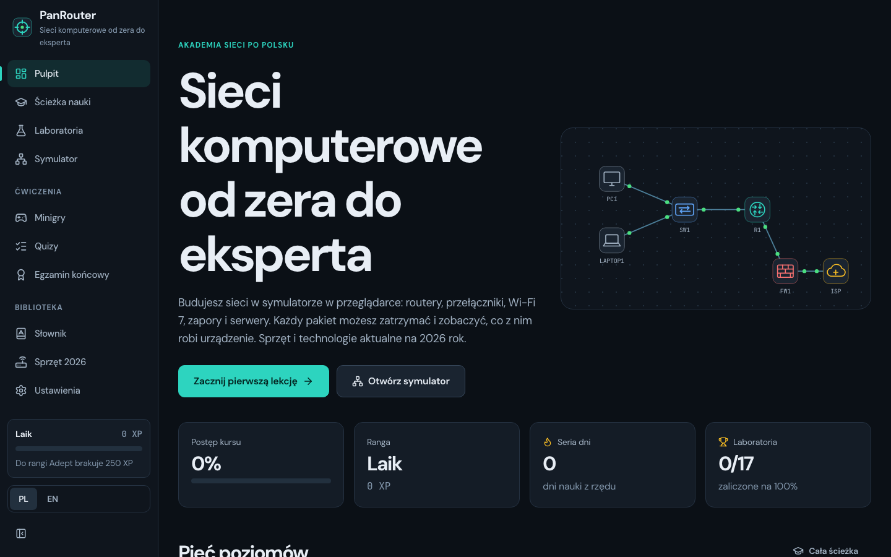

## Who it is for

- **People starting from zero** who want to understand how a network works at home and at work. The first lessons
  assume no knowledge, and every new term is explained with an example.
- **IT vocational school and university students** preparing for vocational exams and networking certifications. The
  labs practice the same things as real lab rooms: addressing, VLANs, routing, OSPF, NAT, ACLs, EtherChannel, VRRP,
  port security, DHCP snooping and device hardening.
- **Teachers** who need a Polish-language simulator to show packet flow in class, with nothing to install.

It is not an emulator of a real router operating system. The simulator models network behavior in a simplified way,
and the device model names are fictional. The CLI syntax is based on the common IOS style, because that is how most
network engineers learn.

## How it works

```
Browser (Preact + TypeScript, no backend)
   │
   ├── src/sim/          network engine: frames, ARP, VLAN, STP, EtherChannel, port security, DHCP snooping,
   │                     routing, OSPF, VRRP/HSRP, DHCP, DNS, NAT, ACL, firewall, Wi-Fi
   │     ├── cli/        IOS-style CLI and computer command line (PL/EN)
   │     └── ui/         SVG canvas, palette, device panels, terminal, simulation mode
   ├── src/content/      lessons, diagrams, quizzes, graded labs, exam, glossary
   ├── src/games/        minigames
   ├── sw.js             service worker generated at build time: the whole app works offline
   └── localStorage      progress, saved networks and settings (nothing goes to a server)
```

**The engine** processes frames as an event queue. Each device decides the way real hardware does: a switch learns MAC
addresses and floods unknown destinations, a router looks for the longest prefix match and ARPs for the next hop, the
firewall tracks sessions, and NAT keeps a translation table. Every decision is written to a trace that simulation mode
uses.

**A ping from a computer** goes like this:

1. The computer checks whether the destination is in its subnet. If not, it sends the packet to the default gateway.
2. It doesn't know the gateway's MAC address, so it holds the packet and broadcasts an ARP request.
3. The switch records which port the sender is behind and floods the broadcast to ports in the same VLAN.
4. The router replies, the computer sends the held packet, and the router forwards it according to its routing table.
5. Each of these steps is visible in simulation mode, together with the Ethernet, IP and ICMP header fields.

**Labs** build a ready topology and check the result, not the way you got there. The "Check results" button runs
tests on a copy of the network: pings, web pages, routes, OSPF adjacencies, ports blocked by STP. Some checks
deliberately break a separate copy, e.g. plug in a foreign laptop or disconnect a cable in a channel. Every lab has a
solution script in the unit tests that proves it can be passed.

## Features

| Path | What it is |
|---|---|
| `#/` | Dashboard: progress, rank, learning streak, levels and shortcuts to exercises |
| `#/nauka` | Learning path: 5 levels, 20 modules, labs at every level |
| `#/nauka/:modul` | A lesson in chapters with diagrams, CLI examples and a quiz at the end |
| `#/laboratoria`, `#/lab/:id` | 23 tasks in the simulator with instructions, hints and grading |
| `#/awaria` | Fault generator: random faults in a ready network, user tickets, hints and a graded fix |
| `#/symulator` | Your own network from scratch or from one of 4 templates, saved networks, file, network link and PNG image |
| `#/gry`, `#/gry/:id` | 10 minigames: binary, subnets, ports, OSI, MAC table, routing, IPv6, troubleshooting, timed CLI |
| `#/quizy`, `#/quiz/:id` | Module quizzes, a quick mix and a mistakes review |
| `#/egzamin` | Final exam: 30 questions in 45 minutes and a network to configure |
| `#/slownik` | 84 terms with search |
| `#/urzadzenia` | 2026 hardware and a list of technologies that are no longer used |
| `#/ustawienia` | Language, reduced motion, terminal, app install, progress backup |

**Simulator**

- 14 device types: edge router, Wi-Fi 7 home router, access switch with PoE, L3 switch, NGFW firewall, Wi-Fi 7 access
  point, internet cloud, computer, laptop, smartphone, server, printer, IP camera and IP phone.
- Copper and fiber cables with port type checks, port LEDs, Wi-Fi range and PoE power.
- CLI: modes, command abbreviations, `?` help, Tab completion, error messages like on real hardware,
  `show running-config`, `show ip route`, `show vlan brief`, `show spanning-tree`, `show ip ospf neighbor`,
  `show ip nat translations`, `show etherchannel summary`, `show vrrp brief`, `show standby brief`,
  `show port-security`, `show ip dhcp snooping binding`, `show ipv6 interface brief`, `show ipv6 route`,
  `show ipv6 neighbors` and more.
- Computer command line in Polish or English: `ipconfig`, `ping`, `tracert`, `nslookup`, `arp -a`, `curl`, `ssh`,
  `telnet`.
- Graphical panels that run real CLI commands and show them under the form.
- Simulation mode: step-by-step playback, protocol filters, packet details layer by layer.
- Layer 2 security: port security (address limit, sticky, shutdown, restrict and protect actions, err-disabled state)
  and DHCP snooping with trusted ports and a binding table.
- Redundancy: EtherChannel with LACP (active, passive) and on mode, suspending mismatched ports, a backup VRRP and HSRP
  gateway with failover.
- Network link: the topology stored in the page URL (deflate compression), no server. The recipient confirms replacing
  their network, and a broken or tampered link is rejected.
- Canvas export to PNG at double resolution, with the project fonts embedded.
- IPv6: static and EUI-64 addresses, link-local addresses, SLAAC on computers, neighbor discovery (NDP), static routes,
  IPv6 ping and traceroute in the router CLI and the computer command line.
- Wireshark-style packet analyzer: a table with No., time, source, destination, protocol, length and info, a display
  filter (`ip.addr == 10.10.10.1 and icmp`, `ipv6`, `tcp.port == 80`, `dropped`), layers, a byte dump and `.pcap`
  export that real Wireshark opens.
- Canvas work: undo and redo (Ctrl+Z, Ctrl+Shift+Z), selecting several devices with a Shift box and moving them
  together, notes on the canvas and up to 30 saved networks under your own names.

**Fault generator**

The simulator breaks one of four ready networks (1, 2 or 3 faults depending on difficulty) and shows the symptoms users
report. Faults cover 15 kinds, from a shut port and a wrong VLAN to missing routes, ACLs, DHCP pools and DNS records.
The fix is graded by how the network works, not by undoing a specific change, so any correct solution counts. The same
ticket number always gives the same fault.

**App**

- Pages load separately, so the first visit downloads about half of the code, and the browser fetches the rest in the
  background.
- PWA: manifest with icons and shortcuts, install on phone and desktop, offline use and a new version notice with a
  refresh button.

## Screenshots

### Learning

| Learning path | Lesson with a diagram |
|---|---|
| 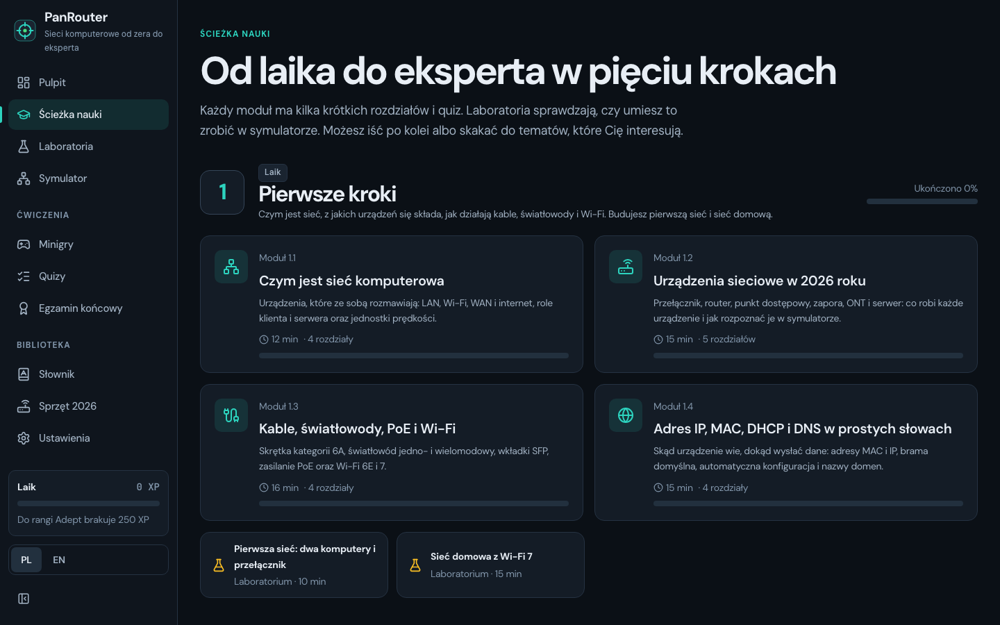 | 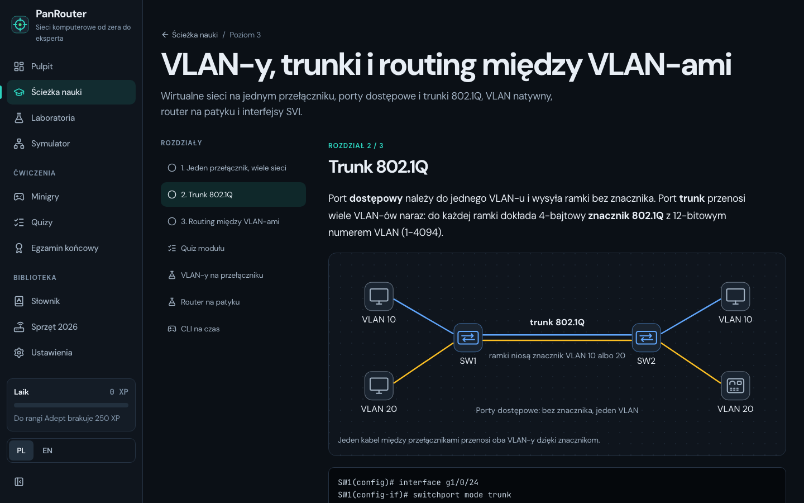 |

| Quiz with an explanation | Final exam |
|---|---|
| 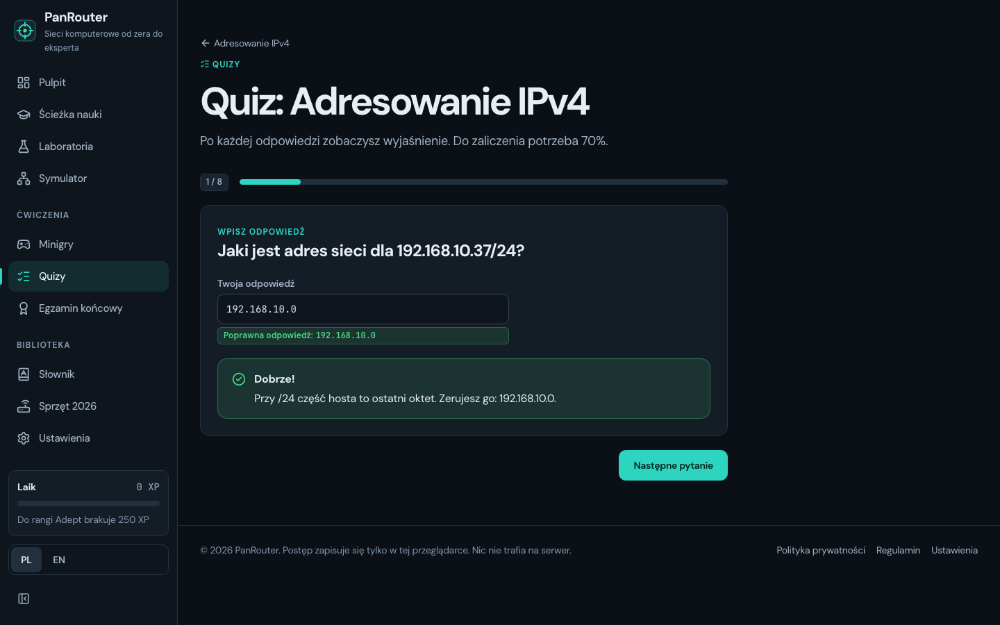 | 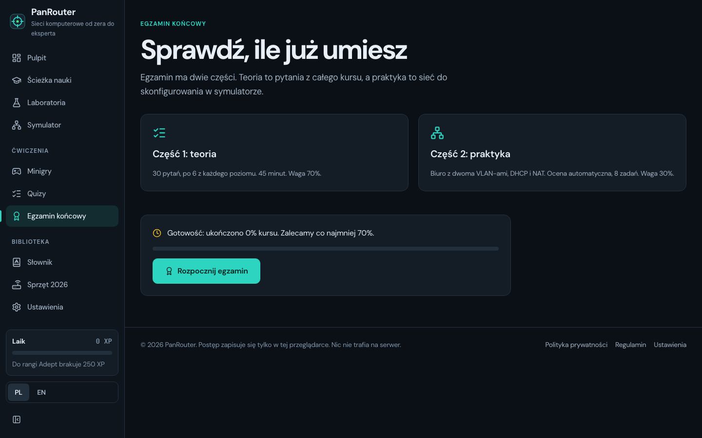 |

### Simulator

| "Small office" template | Router CLI |
|---|---|
| 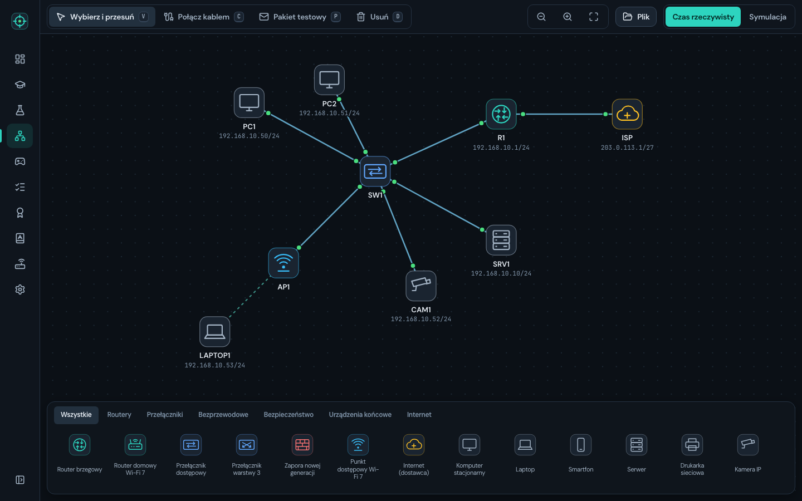 | 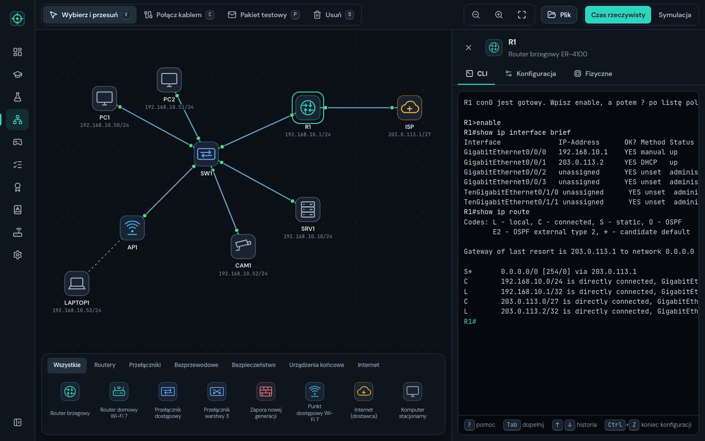 |

| Simulation mode | Graded lab |
|---|---|
| 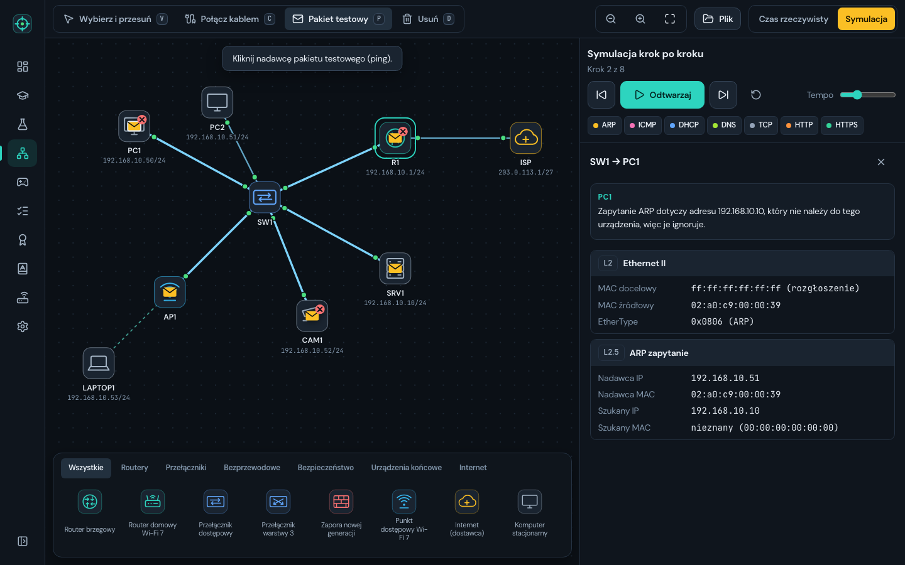 | 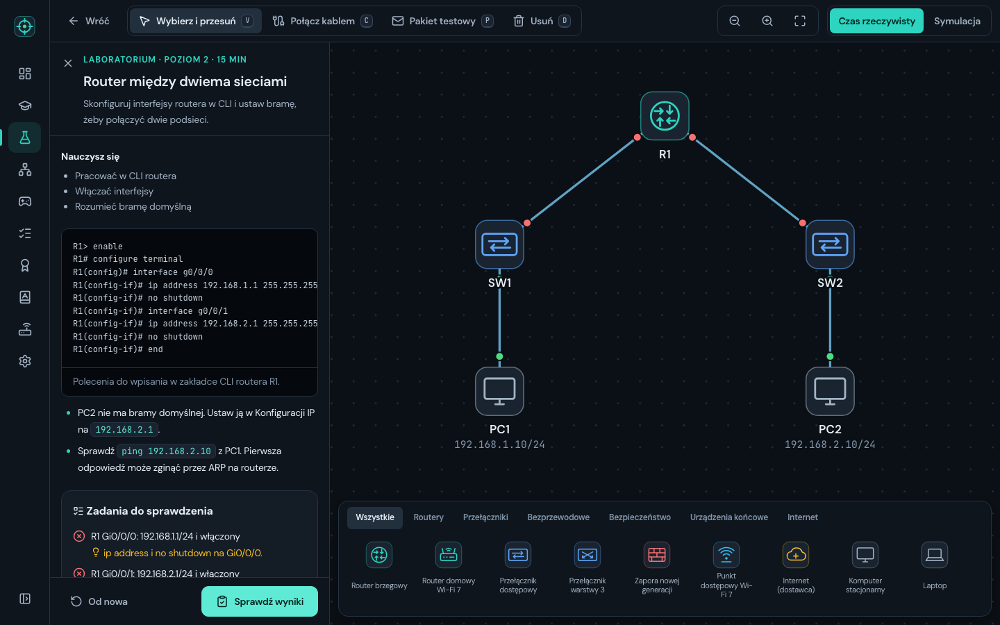 |

### Minigames and library

| Minigames | The "Subnetter" game |
|---|---|
| 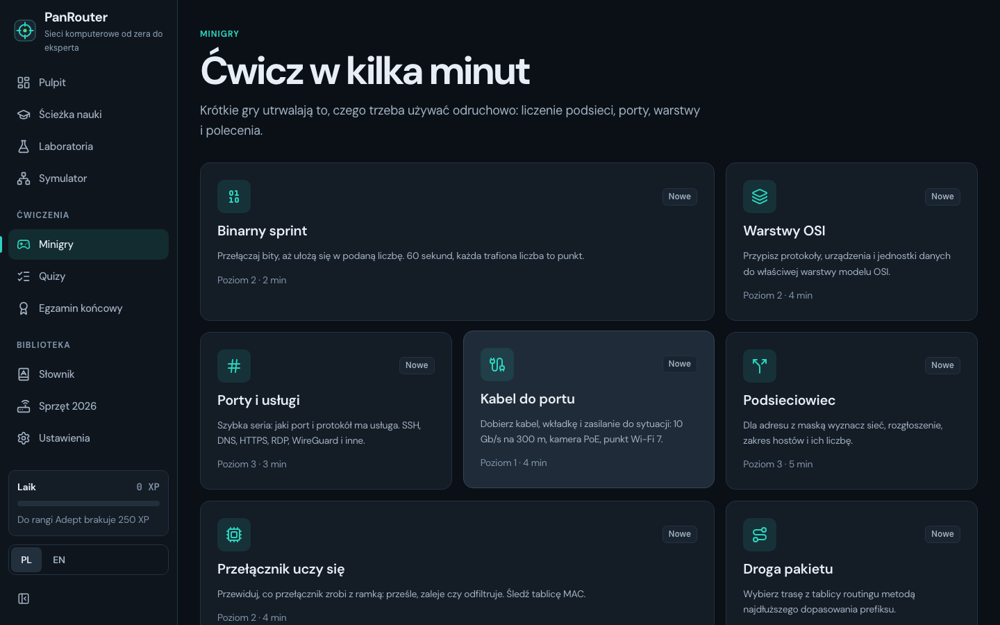 | 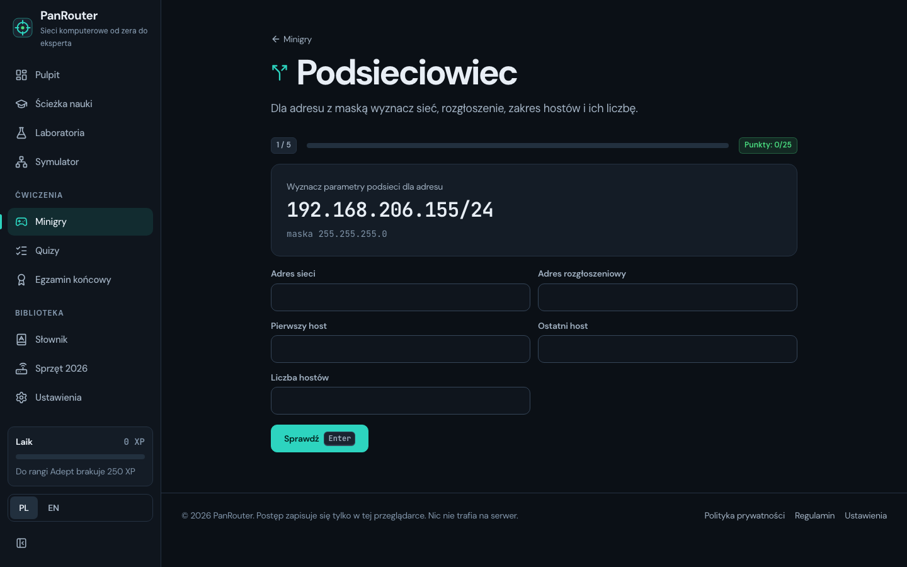 |

| 2026 hardware |
|---|
| 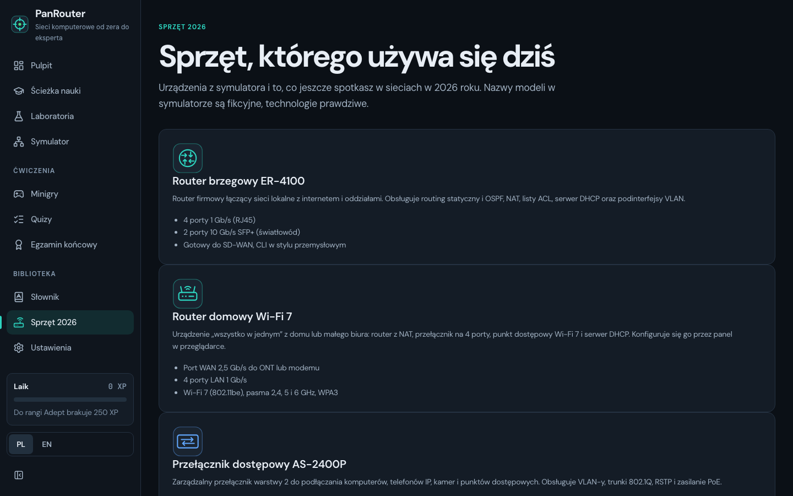 |

### Phone

| Dashboard | Lesson |
|---|---|
| 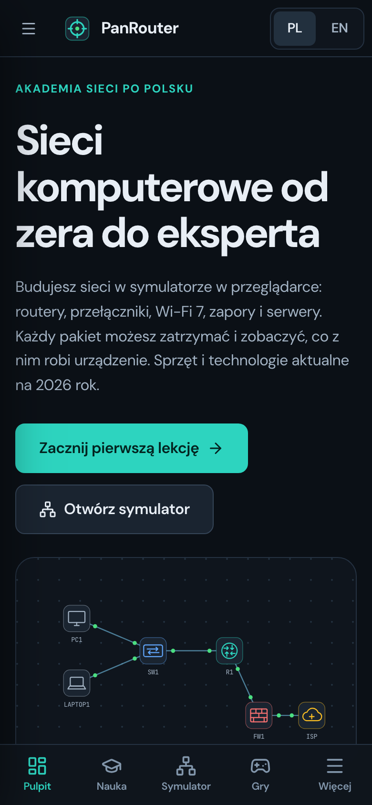 | 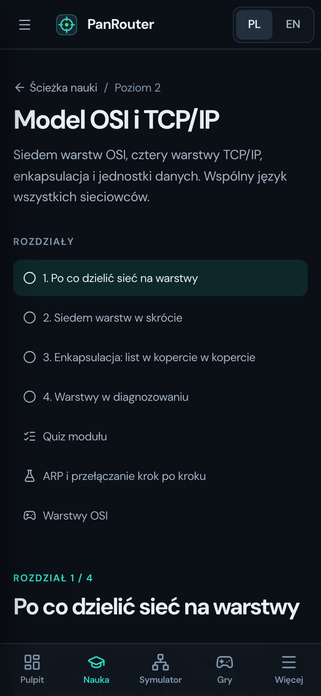 |

All data in the screenshots is sample data. Addresses come from private and documentation ranges. The screenshots show
the Polish version of the interface.

## Getting started

Requires Node.js 20 or newer.

```bash
npm install
npm run dev             # http://127.0.0.1:4400
```

| Script | What it does |
|---|---|
| `npm run dev` | Vite dev server on port 4400 |
| `npm run build` | TypeScript type check and build to `dist/` |
| `npm run preview` | Build preview on port 4401 |
| `npm test` | 111 unit tests (engine, IPv6, CLI, labs, fault generator, analyzer, content) |
| `npm run test:e2e` | 56 Playwright tests with axe accessibility checks, including offline mode on the build |
| `node scripts/assets.mjs` | Regenerates the favicon, app icons and Open Graph image |

The project has no backend, database or environment variables. Progress is stored in the browser's `localStorage`,
and in Settings you can download it to a JSON file and load it on another computer.

## Publishing

The build in `dist/` is plain static files. Routing works through `#`, and asset paths are relative (`base: './'`), so
the site works on GitHub Pages in a repository subfolder with no extra configuration. The service worker
(`dist/sw.js`) is generated on every build with a file list and a version computed from their content, so after
publishing users get a new version notice. In dev mode the service worker is disabled.

The target address is `https://szymonkaczmarczyk.github.io/panrouter/` (set in `index.html`, `public/robots.txt` and
`public/sitemap.xml`). If the domain changes, update these three files.

## Structure

```
src/
  app/              app shell, hash routing, meta tags
  sim/              DOM-free network engine: network, topology (STP, OSPF, routes), engine (frames and services)
    cli/            IOS-style parser and commands, show, host command line
    ui/             canvas, palette, device panels, terminal, simulation panel
    templates.ts    ready networks: home, office, two branches, campus
  content/          course modules, SVG diagrams, labs, exam, glossary
  games/            minigames and their registry
  pages/            app views
  state/            progress, XP and ranks in localStorage
  i18n/             PL/EN interface texts
  styles/           tokens and styles
tests/
  unit/             Vitest: engine, CLI, templates, labs, content
  e2e/              Playwright with axe-core
public/             favicon, app icons, manifest, Open Graph image, robots.txt, sitemap.xml, 404.html
scripts/            icon and OG image generator, service worker build plugin
docs/screenshots/   screenshots used in the README
```

## Security and privacy

- No accounts, cookies, analytics or external resources. Fonts (DM Sans, JetBrains Mono) are self-hosted.
- Text typed by the user reaches the interface only as text, never as inserted HTML.
- Passwords in simulated configurations (`enable secret`, `username ... secret`) are stored as hashes, as the course
  teaches.
- Networks from a file, a link and browser storage are validated: every field has its type and range checked, unknown
  fields are rejected, and link decompression has a size limit.
- Security content is defensive. The course reminds you that you may only test your own networks or networks you have
  written permission for.

## Accessibility

Keyboard navigation with visible focus, keyboard shortcuts shown next to simulator buttons, ARIA labels,
`prefers-reduced-motion` support and a separate reduced motion toggle. E2e tests check pages with axe-core.

## Documentation

- [`docs/screenshots/`](docs/screenshots/) - screenshots of every part of the app used in this README.

## License

The project is released under the MIT license. See [LICENSE](LICENSE) for details.
