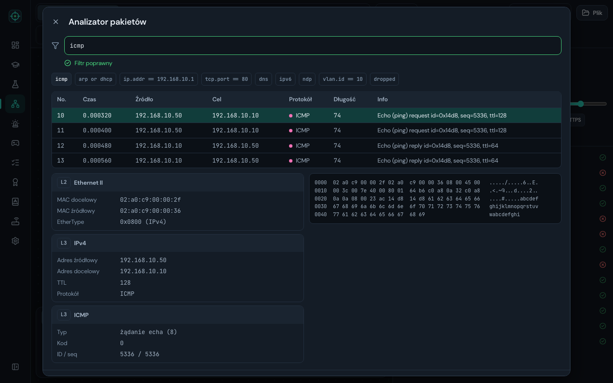
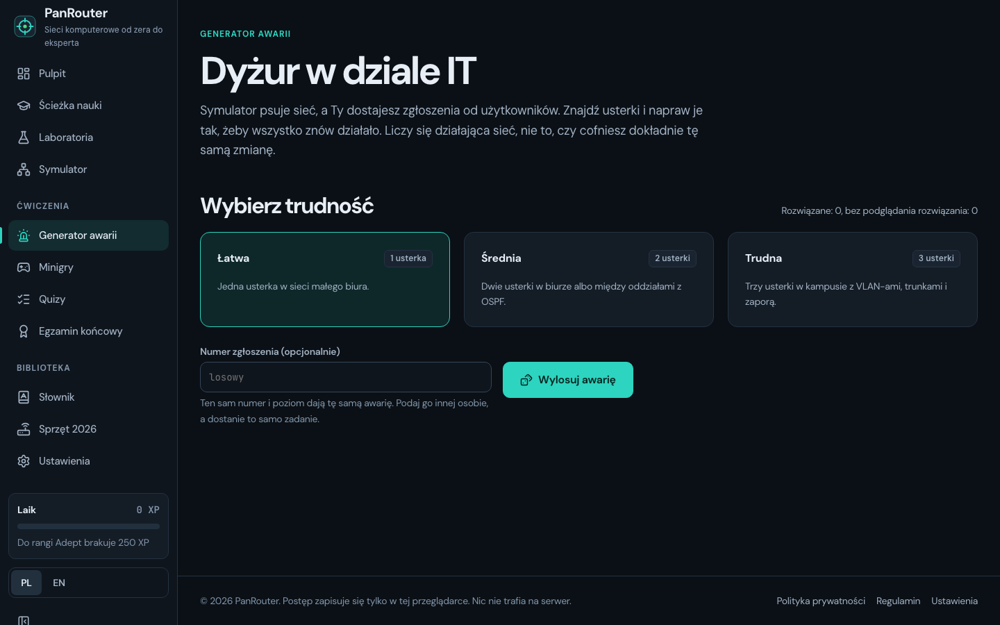
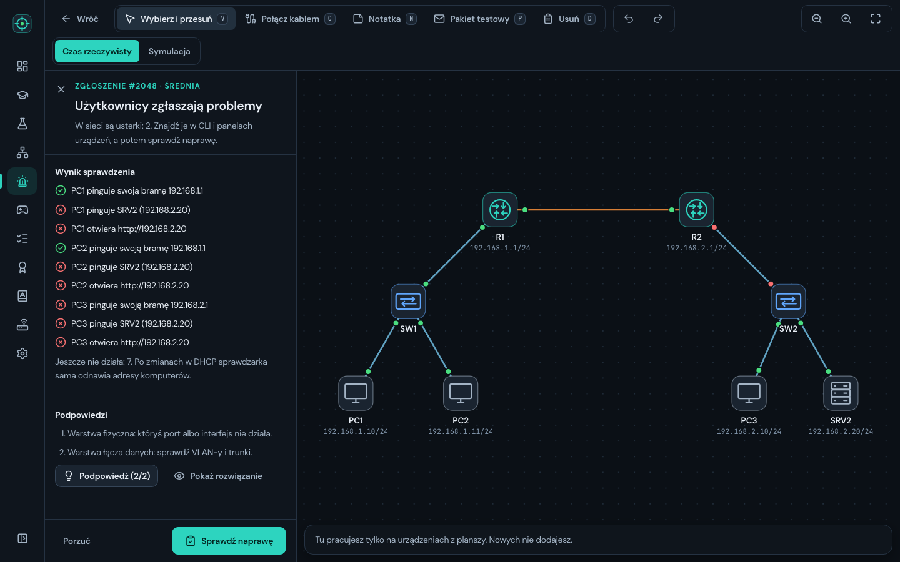
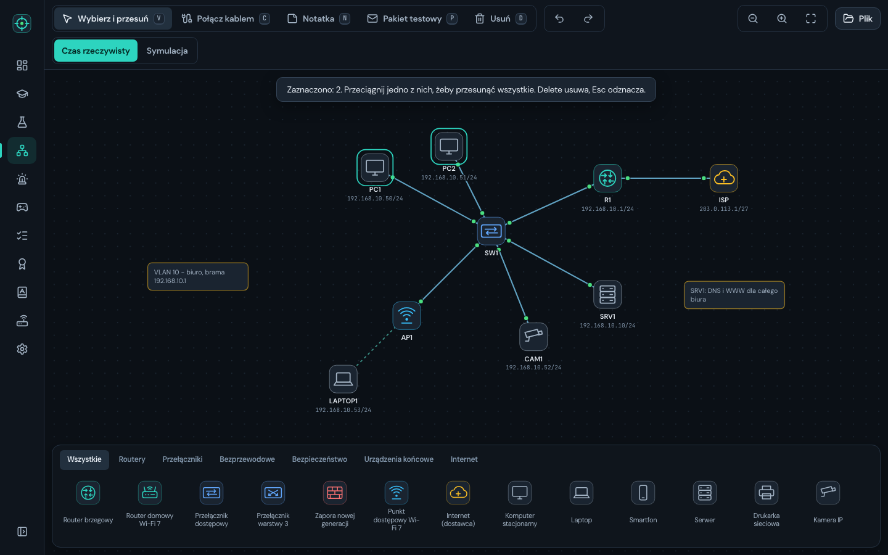
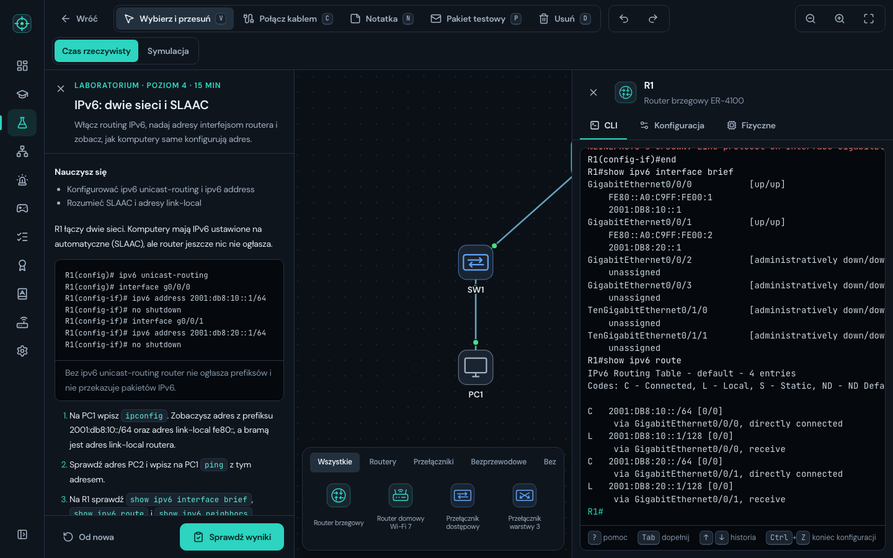
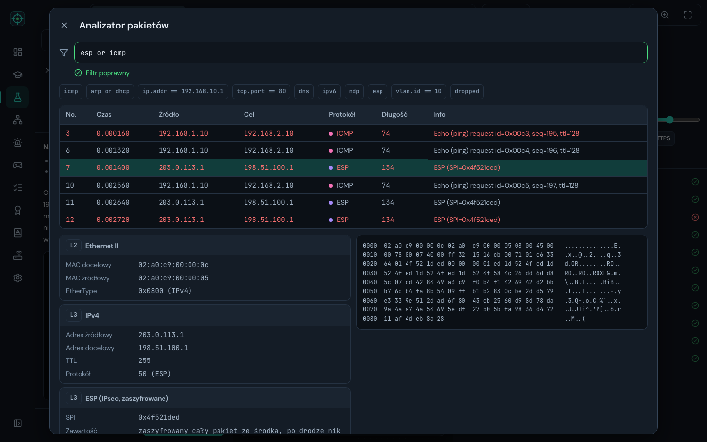
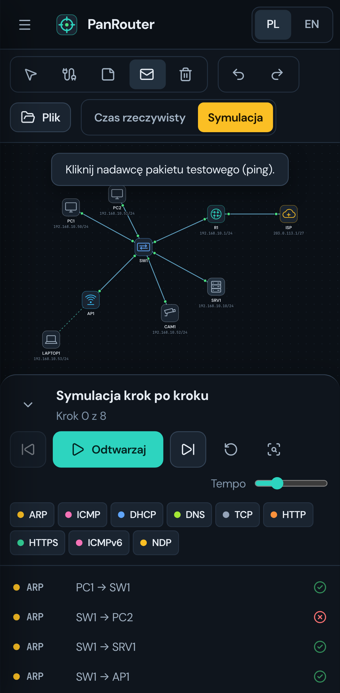

# PanRouter

**Polski** · [English](README.en.md)

> Sieci komputerowe od zera do eksperta. Po polsku, w przeglądarce.

PanRouter to symulator sieci komputerowych w duchu Cisco Packet Tracer połączony z pełnym kursem. Na planszy
stawiasz routery, przełączniki, punkty dostępowe Wi-Fi 7, zapory NGFW, serwery i komputery, łączysz je kablem
miedzianym albo światłowodem i konfigurujesz w CLI lub w panelach. Tryb symulacji zatrzymuje każdy pakiet
i tłumaczy po polsku, co z nim zrobiło urządzenie: ARP, przełączanie, VLAN-y, routing, NAT, DHCP, DNS, zapora i IPv6.
Ruch można też obejrzeć w analizatorze pakietów w stylu Wiresharka i zapisać do pliku `.pcap`.
Sieć można wysłać komuś jednym linkiem, zapisać jako obraz PNG, a całą aplikację zainstalować i używać bez internetu.

Wokół symulatora jest ścieżka nauki: 20 modułów na pięciu poziomach (od laika do eksperta), quizy z wyjaśnieniami,
25 laboratoriów z automatyczną oceną, laboratoria z linku od prowadzącego, generator losowych awarii, 10 minigier i egzamin końcowy z częścią praktyczną. Całość działa po polsku,
a jednym przyciskiem przełącza się na angielski. Sprzęt i technologie są aktualne na 2026 rok.


## Dla kogo

- **Dla osób, które zaczynają od zera** i chcą zrozumieć, jak działa sieć w domu i w firmie. Pierwsze lekcje nie
  zakładają żadnej wiedzy, a każdy nowy termin jest wyjaśniony na przykładzie.
- **Dla uczniów techników informatycznych i studentów**, którzy przygotowują się do egzaminów zawodowych
  i certyfikacji sieciowych. Laboratoria ćwiczą to samo, co prawdziwe pracownie: adresację, VLAN-y, routing,
  OSPF, NAT, listy ACL, EtherChannel, VRRP, port security, DHCP snooping i zabezpieczanie urządzeń.
- **Dla nauczycieli**, którzy potrzebują polskojęzycznego symulatora do pokazania ruchu pakietów na lekcji,
  bez instalowania czegokolwiek.

To nie jest emulator prawdziwego systemu operacyjnego routera. Symulator odwzorowuje zachowanie sieci w sposób
uproszczony, a nazwy modeli urządzeń są fikcyjne. Składnia CLI jest wzorowana na powszechnym stylu IOS, bo tak
uczy się większość sieciowców.

## Jak to działa

```
Przeglądarka (Preact + TypeScript, bez backendu)
   │
   ├── src/sim/          silnik sieci: ramki, ARP, VLAN, STP, EtherChannel, port security, DHCP snooping,
   │                     routing, OSPF, VRRP/HSRP, DHCP, DNS, NAT, ACL, zapora, Wi-Fi
   │     ├── cli/        CLI w stylu IOS i wiersz poleceń komputerów (PL/EN)
   │     └── ui/         plansza SVG, paleta, panele urządzeń, terminal, tryb symulacji
   ├── src/content/      lekcje, diagramy, quizy, laboratoria z oceną, egzamin, słownik
   ├── src/games/        minigry
   ├── sw.js             service worker generowany przy buildzie: cała aplikacja działa offline
   └── localStorage      postęp, zapisane sieci i ustawienia (nic nie trafia na serwer)
```

**Silnik** przetwarza ramki jako kolejkę zdarzeń. Każde urządzenie podejmuje decyzję tak jak prawdziwy sprzęt:
przełącznik uczy się adresów MAC i zalewa nieznane cele, router szuka trasy z najdłuższym prefiksem i pyta ARP
o następny skok, zapora pamięta sesje, a NAT prowadzi tablicę translacji. Każda decyzja zapisuje się
w śladzie, z którego korzysta tryb symulacji.

**Ping z komputera** przechodzi taką drogę:

1. Komputer sprawdza, czy cel jest w jego podsieci. Jeśli nie, wysyła pakiet do bramy domyślnej.
2. Nie zna adresu MAC bramy, więc wstrzymuje pakiet i rozgłasza zapytanie ARP.
3. Przełącznik zapisuje, za którym portem jest nadawca, i zalewa rozgłoszenie do portów w tym samym VLAN-ie.
4. Router odpowiada, komputer wysyła wstrzymany pakiet, a router przekazuje go dalej według tablicy routingu.
5. Każdy z tych kroków widać w trybie symulacji, razem z polami nagłówków Ethernet, IP i ICMP.

**Laboratoria** budują gotową topologię i sprawdzają wynik, a nie sposób wykonania. Przycisk „Sprawdź wyniki”
uruchamia testy na kopii sieci: pingi, strony WWW, trasy, sąsiedztwa OSPF, porty zablokowane przez STP.
Niektóre sprawdzenia celowo psują osobną kopię, np. podłączają obcy laptop albo odłączają kabel w kanale.
Każde laboratorium ma w testach jednostkowych skrypt rozwiązania, który udowadnia, że da się je zaliczyć.

## Funkcje

| Adres | Co to jest |
|---|---|
| `#/` | Pulpit: postęp, ranga, seria dni nauki, poziomy i skróty do ćwiczeń |
| `#/nauka` | Ścieżka nauki: 5 poziomów, 20 modułów, laboratoria przy każdym poziomie |
| `#/nauka/:modul` | Lekcja w rozdziałach z diagramami, przykładami CLI i quizem na końcu |
| `#/laboratoria`, `#/lab/:id` | 25 zadań w symulatorze z instrukcją, podpowiedziami i oceną |
| `#/lab-z-linku?lab=…` | Laboratorium przygotowane przez prowadzącego: sieć, polecenie i warunki zaliczenia zapisane w linku |
| `#/awaria` | Generator awarii: losowe usterki w gotowej sieci, zgłoszenia od użytkowników, podpowiedzi i ocena naprawy |
| `#/symulator` | Własna sieć od zera albo z jednego z 4 szablonów, zapisane sieci, plik, link do sieci i obraz PNG |
| `#/gry`, `#/gry/:id` | 10 minigier: binarnie, podsieci, porty, OSI, tablica MAC, routing, IPv6, diagnostyka, CLI na czas |
| `#/quizy`, `#/quiz/:id` | Quizy modułów, szybki miks i powtórka błędów |
| `#/powtorki` | Powtórki na dziś: błędne pytania i wybrane hasła ze słownika wracają po 1, 3 i 7 dniach |
| `#/statystyki` | Wykres podejść do egzaminu, tabela wyników, najsłabsze moduły, awarie i powtórki |
| `#/egzamin` | Egzamin końcowy: 30 pytań w 45 minut i sieć do skonfigurowania |
| `#/slownik` | 88 pojęć z wyszukiwarką i przyciskiem „Powtarzaj” przy każdym haśle |
| `#/urzadzenia` | Sprzęt 2026 i lista technologii, których już się nie używa |
| `#/ustawienia` | Język, ograniczenie animacji, terminal, instalacja aplikacji, kopia zapasowa postępu |

**Symulator**

- 14 rodzajów urządzeń: router brzegowy, router domowy Wi-Fi 7, przełącznik dostępowy z PoE, przełącznik L3,
  zapora NGFW, punkt dostępowy Wi-Fi 7, chmura internetu, komputer, laptop, smartfon, serwer, drukarka,
  kamera IP i telefon IP.
- Kable miedziane i światłowodowe z kontrolą typu portu, diody portów, zasięg Wi-Fi i zasilanie PoE.
- CLI: tryby, skróty poleceń, pomoc pod `?`, dopełnianie klawiszem Tab, komunikaty błędów jak na sprzęcie,
  `show running-config`, `show ip route`, `show vlan brief`, `show spanning-tree`, `show ip ospf neighbor`,
  `show ip nat translations`, `show etherchannel summary`, `show vrrp brief`, `show standby brief`,
  `show port-security`, `show ip dhcp snooping binding`, `show ipv6 interface brief`, `show ipv6 route`,
  `show ipv6 neighbors` i inne.
- Wiersz poleceń komputerów po polsku lub angielsku: `ipconfig`, `ping`, `tracert`, `nslookup`, `arp -a`,
  `curl`, `ssh`, `telnet`.
- Panele graficzne, które wykonują prawdziwe polecenia CLI i pokazują je pod formularzem.
- Tryb symulacji: odtwarzanie krok po kroku, filtry protokołów, szczegóły pakietu warstwa po warstwie.
- Bezpieczeństwo warstwy 2: port security (limit adresów, sticky, reakcje shutdown, restrict i protect, stan
  err-disabled) oraz DHCP snooping z portami zaufanymi i tablicą powiązań.
- Redundancja: EtherChannel z LACP (active, passive) i trybem on, zawieszanie niezgodnych portów, zapasowa brama
  VRRP i HSRP z przełączeniem po awarii.
- Link do sieci: topologia zapisana w adresie strony (kompresja deflate), bez serwera. Odbiorca potwierdza
  zastąpienie swojej sieci, a uszkodzony lub spreparowany link jest odrzucany.
- Eksport planszy do PNG w podwójnej rozdzielczości, z osadzonymi fontami projektu.
- IPv6: adresy statyczne i EUI-64, adresy link-local, SLAAC na komputerach, odkrywanie sąsiadów (NDP), trasy
  statyczne, ping i traceroute po IPv6 w CLI routera i w wierszu poleceń komputera.
- OSPFv3 (`ipv6 router ospf`, `ipv6 ospf 1 area 0`, `show ipv6 ospf neighbor`) z trasami przez adresy link-local
  i DHCPv6 stanowe oraz bezstanowe (`ipv6 dhcp pool`, flagi `managed-config-flag` i `other-config-flag`).
- VPN między oddziałami: tunel `Tunnel0` w trybie IPsec (`crypto isakmp key`, `crypto ipsec profile`,
  `tunnel protection`) albo GRE. W analizatorze po drodze widać tylko ESP z adresami routerów, a w GRE pakiet
  ze środka. Różne klucze zostawiają tunel w stanie down (`show crypto isakmp sa`).
- Analizator pakietów jak w Wiresharku: tabela z kolumnami No., czas, źródło, cel, protokół, długość i info, filtr
  wyświetlania (`ip.addr == 10.10.10.1 and icmp`, `ipv6`, `esp`, `tcp.port == 80`, `dropped`), warstwy, zrzut bajtów
  i eksport do `.pcap`, który otwiera prawdziwy Wireshark.
- Praca na planszy: cofanie i ponawianie (Ctrl+Z, Ctrl+Shift+Z), zaznaczanie wielu urządzeń ramką z Shift
  i przesuwanie ich razem, notatki na planszy oraz do 30 zapisanych sieci pod własnymi nazwami.
- Krótki samouczek przy pierwszym wejściu na pustą planszę: dwa komputery, kabel i ping. Zamyka się sam,
  gdy ktoś wczyta gotową sieć.
- Na telefonie panel symulacji jest zwijanym arkuszem, a widok planszy omija podpowiedzi i panele.

**Generator awarii**

Symulator psuje jedną z czterech gotowych sieci (1, 2 albo 3 usterki zależnie od trudności) i pokazuje objawy
zgłaszane przez użytkowników. Usterki obejmują 15 rodzajów, od wyłączonego portu i złego VLAN-u po brakujące trasy,
listy ACL, pule DHCP i rekordy DNS. Naprawa jest oceniana po działaniu sieci, a nie po cofnięciu konkretnej zmiany,
więc liczy się każde poprawne rozwiązanie. Ten sam numer zgłoszenia zawsze daje tę samą awarię.

**Nauka i postępy**

- Powtórki rozłożone w czasie: błędna odpowiedź w quizie albo na egzaminie wraca po 1 dniu, dobra przesuwa ją
  na 3, potem na 7 dni, a po trzech dobrych z rzędu znika. Hasła ze słownika działają jak fiszki z klawiszami
  1 i 2. Pulpit pokazuje „Na dziś: N powtórek”.
- Historia egzaminu: każde podejście zapisuje teorię, praktykę i błędy w podziale na moduły. Strona statystyk
  rysuje wykres podejść z progiem 75% i wskazuje najsłabsze moduły z linkiem do lekcji.

**Laboratorium z linku**

Prowadzący buduje sieć w symulatorze i wybiera Plik, a potem „Zrób z tej sieci laboratorium”. Wpisuje tytuł,
polecenie i warunki (np. „PC1 pinguje SRV1”, „PC2 nie pinguje 10.0.0.5”, „PC1 otwiera http://…”), sprawdza je
na swojej sieci i kopiuje link. Osoba ucząca się dostaje tę sieć z instrukcją i przyciskiem „Sprawdź wyniki”,
a jej praca zapisuje się w przeglądarce osobno dla każdego linku.

**Aplikacja**

- Strony ładują się osobno, więc pierwsze wejście pobiera około połowy kodu, a resztę przeglądarka dociąga
  w tle.
- PWA: manifest z ikonami i skrótami, instalacja na telefonie i komputerze, praca bez internetu i komunikat
  o nowej wersji z przyciskiem odświeżenia.

## Zrzuty ekranu

### Nauka

| Ścieżka nauki | Lekcja z diagramem |
|---|---|
|  |  |

| Quiz z wyjaśnieniem | Egzamin końcowy |
|---|---|
|  |  |

### Symulator

| Szablon „Małe biuro” | CLI routera |
|---|---|
|  |  |

| Tryb symulacji | Laboratorium z oceną |
|---|---|
|  |  |

### Analiza, awarie i IPv6

| Analizator pakietów | Generator awarii |
|---|---|
|  |  |

| Zgłoszenie do naprawy | Notatki i zaznaczanie grupy |
|---|---|
|  |  |

| Laboratorium IPv6 | VPN IPsec w analizatorze |
|---|---|
|  |  |

### Minigry i biblioteka

| Minigry | Gra „Podsieciowiec” |
|---|---|
|  |  |

| Sprzęt 2026 |
|---|
|  |

### Telefon

| Pulpit | Lekcja |
|---|---|
|  |  |

| Symulacja na telefonie |
|---|
|  |

Wszystkie dane na zrzutach są przykładowe. Adresy pochodzą z zakresów prywatnych i dokumentacyjnych.

## Uruchomienie

Wymagany Node.js 20 lub nowszy.

```bash
npm install
npm run dev             # http://127.0.0.1:4400
```

| Skrypt | Co robi |
|---|---|
| `npm run dev` | Serwer deweloperski Vite na porcie 4400 |
| `npm run build` | Sprawdzenie typów TypeScript i build do `dist/` |
| `npm run preview` | Podgląd builda na porcie 4401 |
| `npm test` | 129 testów jednostkowych (silnik, IPv6, OSPFv3, DHCPv6, VPN, CLI, laboratoria, powtórki, generator awarii, analizator, treści) |
| `npm run test:e2e` | 74 testy Playwright (komputer i telefon) z kontrolą dostępności axe, także tryb offline na buildzie |
| `node scripts/assets.mjs` | Ponowne wygenerowanie favicony, ikon aplikacji i obrazu Open Graph |

Projekt nie ma backendu, bazy danych ani zmiennych środowiskowych. Postęp zapisuje się w `localStorage`
przeglądarki, a w Ustawieniach można go pobrać do pliku JSON i wczytać na innym komputerze.

## Publikacja

Build w `dist/` to zwykłe pliki statyczne. Routing działa przez `#`, a ścieżki zasobów są względne
(`base: './'`), więc strona działa na GitHub Pages w podkatalogu repozytorium bez dodatkowej konfiguracji.
Service worker (`dist/sw.js`) powstaje przy każdym buildzie z listą plików i wersją liczoną z ich zawartości,
więc po publikacji użytkownicy dostaną komunikat o nowej wersji. W trybie deweloperskim service worker jest wyłączony.

Workflow `.github/workflows/ci.yml` przy każdym pushu i pull requeście sprawdza typy, uruchamia testy jednostkowe,
build i testy e2e, a z gałęzi `main` publikuje `dist/` na GitHub Pages. W ustawieniach repozytorium
(Settings, Pages, Source) trzeba raz wybrać „GitHub Actions”.

Docelowy adres to `https://szymonkaczmarczyk.github.io/panrouter/` (ustawiony w `index.html`, `public/robots.txt`
i `public/sitemap.xml`). Przy zmianie domeny popraw te trzy pliki.

## Struktura

```
src/
  app/              powłoka aplikacji, routing przez hash, meta tagi
  sim/              silnik sieci bez DOM: network, topology (STP, OSPF, trasy), engine (ramki i usługi)
    cli/            parser i polecenia w stylu IOS, show, wiersz poleceń hostów
    ui/             plansza, paleta, panele urządzeń, terminal, panel symulacji
    templates.ts    gotowe sieci: dom, biuro, dwa oddziały, kampus
  content/          moduły kursu, diagramy SVG, laboratoria, egzamin, słownik
  games/            minigry i ich rejestr
  pages/            widoki aplikacji
  state/            postęp, XP i rangi w localStorage
  i18n/             teksty interfejsu PL/EN
  styles/           tokeny i style
tests/
  unit/             Vitest: silnik, CLI, szablony, laboratoria, treści
  e2e/              Playwright z axe-core
public/             favicon, ikony aplikacji, manifest, obraz Open Graph, robots.txt, sitemap.xml, 404.html
scripts/            generator ikon i obrazu OG, wtyczka budująca service worker
docs/screenshots/   zrzuty ekranu używane w README
.github/workflows/  testy, build i publikacja na GitHub Pages
```

## Bezpieczeństwo i prywatność

- Brak kont, ciasteczek, analityki i zewnętrznych zasobów. Fonty (DM Sans, JetBrains Mono) są hostowane lokalnie.
- Tekst wpisywany przez użytkownika trafia do interfejsu wyłącznie jako tekst, bez wstawiania HTML.
- Hasła w symulowanych konfiguracjach (`enable secret`, `username ... secret`) są zapisywane jako skróty,
  tak jak uczy tego kurs.
- Sieci z pliku, z linku i z pamięci przeglądarki przechodzą walidację: każde pole ma sprawdzany typ i zakres,
  nieznane pola są odrzucane, a dekompresja linku ma limit rozmiaru.
- Treści o bezpieczeństwie mają charakter obronny. Kurs przypomina, że testować wolno tylko własne sieci
  albo sieci, na które ma się pisemną zgodę.

## Dostępność

Nawigacja klawiaturą z widocznym fokusem, skróty klawiszowe pokazane przy przyciskach symulatora, etykiety ARIA,
obsługa `prefers-reduced-motion` i osobny przełącznik ograniczenia animacji. Testy e2e sprawdzają strony
narzędziem axe-core.

## Licencja

Projekt jest udostępniony na licencji MIT. Szczegóły w pliku [LICENSE](LICENSE).
